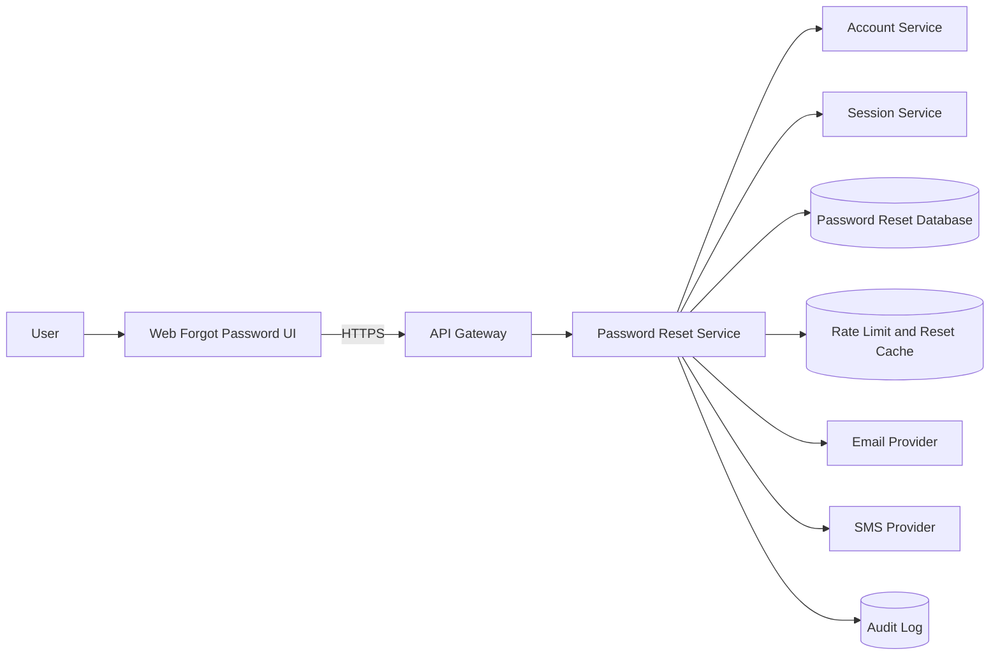

# Password Reset High-Level Architecture

## Architecture Overview

The password-reset capability is designed as a separate application service within the existing web authentication system. A web client initiates the flow, the Password Reset Service coordinates verification and password changes, and existing account, session, email, and SMS capabilities provide external system integration.

The design uses a modular, stateless service behind an API gateway. Reset state is stored in a managed database and cache. Secrets are never returned to the web client or written to audit logs.



## Technology Stack

| Area | Proposed Technology | Reason |
|---|---|---|
| Web client | Existing web application framework | Reuses the existing sign-in experience and supports the web-only requirement |
| API gateway | Existing gateway or load balancer | Centralizes HTTPS termination, request routing, limits, and security controls |
| Password Reset Service | REST service in the existing application language and runtime | Keeps reset logic isolated and consistent with the existing platform |
| Database | Managed relational database | Supports reset state, password history, and durable account references |
| Cache | Redis-compatible managed cache | Supports sliding-window rate limits and short-lived reset state |
| Email integration | Existing email provider or service | Sends reset links and success notifications |
| SMS integration | Existing SMS provider or service | Sends verification codes |
| Audit storage | Existing centralized application audit system | Records security events without password or reset-secret values |

The exact implementation language and provider should match the approved application stack. No additional framework is required for this architecture.

## Major Components

### Web Password Reset Experience

- Displays the password-reset action on the sign-in page.
- Collects an email address or phone number.
- Renders link and SMS verification steps.
- Collects and confirms the new password.
- Returns generic messages for reset-request outcomes.

### API Gateway

- Accepts HTTPS requests.
- Applies baseline request controls and routing.
- Protects internal services from direct public access.

### Password Reset Service

- Coordinates reset requests and verification.
- Resolves identifiers through the Account Service.
- Generates and validates reset links and SMS codes.
- Enforces 1-hour expiration and 15-minute abuse limits.
- Uses atomic state transitions and optimistic locking.
- Generates separate reset-link secrets and browser/session binding values.
- Validates password rules and password history.
- Invalidates reset state after success.
- Coordinates session revocation and success notification.

### Account Service

- Resolves email addresses or phone numbers to account identifiers.
- Provides registered contact details to the Password Reset Service.
- Updates the password credential after verified reset.
- Supports password-history validation.

### Session Service

- Keeps the current reset session active.
- Revokes all other active sessions for the account after success.

### Email and SMS Adapters

- Encapsulate provider-specific integration.
- Send reset links and codes.
- Send the successful-reset email notification.
- Report delivery status.

### Audit Service

- Records timestamped success and failure events.
- Records the relevant account identifier.
- Does not receive passwords or reset secrets.

## Component Responsibilities

| Component | Responsibility |
|---|---|
| Web UI | User interaction and client-side display validation |
| API Gateway | External entry point and network-level controls |
| Password Reset Service | Reset workflow orchestration and verification logic |
| Account Service | Identity lookup and credential/password-history operations |
| Session Service | Session preservation and revocation |
| Email Adapter | Reset link and success notification delivery |
| SMS Adapter | Verification-code delivery |
| Cache | Expiring reset state and rate-limit counters |
| Reset Database | Durable reset metadata and password-history references |
| Audit Service | Security event recording |

## Database Design

### Suggested Tables

#### accounts

The account table is expected to exist in the existing system. The reset architecture references it by internal account identifier.

| Column | Type | Purpose |
|---|---|---|
| account_id | UUID, primary key | Internal account identity |
| email_address | Unique protected string | Registered email lookup |
| phone_number | Unique protected string | Registered phone lookup |
| password_credential_id | UUID / foreign key | Active password credential |

#### password_reset_requests

| Column | Type | Purpose |
|---|---|---|
| reset_request_id | UUID, primary key | Identifies a reset flow |
| account_id | UUID, foreign key | Account being reset |
| link_hash | Hash | One-way hash of the email reset token |
| sms_code_hash | Hash | One-way hash of the SMS code |
| created_at | Timestamp | Starts the 1-hour validity period |
| expires_at | Timestamp | Explicit expiration time |
| link_verified_at | Timestamp, nullable | Records email-link verification |
| sms_verified_at | Timestamp, nullable | Records SMS-code verification |
| sms_attempt_count | Integer | Tracks code attempts |
| reset_session_nonce_hash | Hash | Binds the browser session to the reset request |
| link_secret_hash | Hash | Binds the email link secret to the request |
| delivery_state | Enum | Pending, sent, failed |
| issued_at | Timestamp | Records factor issuance |
| consumed_at | Timestamp, nullable | Records one-time-factor consumption |
| invalidation_reason | String, nullable | Records expiry, completion, or invalidation |
| version | Integer | Supports optimistic locking |
| status | Enum | Pending, verified, completed, expired, invalidated |

Reset tokens and SMS codes are not stored in plaintext.
Email-link and browser/session secrets are separately hashed and never included in audit records.

#### password_credentials

| Column | Type | Purpose |
|---|---|---|
| credential_id | UUID, primary key | Credential identifier |
| account_id | UUID, foreign key | Owning account |
| password_hash | Protected string | Password-derived hash |
| created_at | Timestamp | Used for password history |
| active | Boolean | Identifies the current credential |

Password credentials use an appropriate adaptive password hashing function.

#### password_history

| Column | Type | Purpose |
|---|---|---|
| account_id | UUID, foreign key | Owning account |
| password_hash | Protected string | Historical password hash |
| changed_at | Timestamp | Credential replacement time |

Password-history validation supports checking the latest 5 password hashes.

#### audit_events

| Column | Type | Purpose |
|---|---|---|
| event_id | UUID, primary key | Event identifier |
| event_type | String | Reset requested, verification succeeded/failed, reset succeeded/failed |
| account_identifier | Protected string or account ID | Identifier associated with the event |
| occurred_at | Timestamp | Event time |
| outcome | Enum | Success or failure |

Audit events must not contain passwords or reset secrets.

### Cache Design

The cache stores:

- Reset request identifier and verification status.
- SMS verification attempt counts.
- Sliding-window reset-request counts keyed by account, IP/network, and device.
- Short-lived reset state.

Cache entries expire with the reset or 15-minute limit window.
Persistent database counters are authoritative for SMS attempts and reset completion; cache state is advisory and cannot reset or bypass the database limit.

## API Design

All endpoints use HTTPS. Request and response bodies use JSON. Reset secrets and browser/session nonces are not logged or returned in response bodies.

### POST /api/password-reset/requests

Starts the reset flow.

```json
{
  "identifier": "user@example.com"
}
```

Behavior:

- Accepts an email address or phone number.
- Returns the same generic response for known and unknown identifiers.
- For a matching account, creates a reset request and sends the email link and SMS code.
- Applies 3-request-per-15-minute limits across account and source keys.
- Uses bounded dummy work and identical timing targets for unknown identifiers.
- Includes provider and delivery limits outside the public request path.

```json
{
  "message": "If an eligible account exists, reset instructions have been sent."
}
```

### POST /api/password-reset/links/verify

Exchanges a high-entropy link secret from the email for a short-lived reset-session state.

```json
{
  "linkSecret": "opaque-email-link-secret"
}
```

The link secret is a cryptographically random one-time value, is never placed in application logs or audit events, and is compared as a hash. This operation sets a short-lived HttpOnly, Secure, SameSite reset cookie containing a browser-bound server nonce. GET requests must not mutate reset state or consume the link.

### POST /api/password-reset/verify-code

Verifies the SMS code against the bound reset request.

```json
{
  "resetRequestId": "opaque-request-id",
  "smsCode": "user-entered-code"
}
```

Behavior:

- Allows no more than 5 attempts in 15 minutes.
- Requires the request, email link, and SMS code to belong to the same flow.
- Requires the reset-session nonce to match the browser state.
- Atomically increments the authoritative attempt count before checking the code.
- Locks or rejects the request after the fifth failed attempt.
- Uses a KMS-backed keyed HMAC or dedicated adaptive verifier for low-entropy SMS codes.
- Returns generic verification failure responses.

### POST /api/password-reset/password

Completes password reset.

```json
{
  "resetRequestId": "opaque-request-id",
  "newPassword": "sensitive-value",
  "confirmationPassword": "sensitive-value"
}
```

Behavior:

- Requires a previously verified email link and SMS code.
- Requires the reset-session nonce and reset-request version to match the verified browser flow.
- Validates at least 12 characters, at least one uppercase letter, at least one number, matching confirmation, and no match with the latest 5 passwords.
- Atomically validates and updates the password credential, password history, reset status, consumed factors, and reset completion in one transaction or durable state-machine operation.
- Is idempotent and rejects stale request versions.
- Updates account session-generation state or revokes refresh tokens and remember-me credentials in the completion operation.

Passwords must not be logged, cached, included in URLs, or persisted as plaintext.

## Data Flow

### Request Reset

1. The user opens the sign-in page and selects password reset.
2. The web client sends the email or phone identifier.
3. The API gateway routes the request to the Password Reset Service.
4. The service applies reset-request rate limiting for account, IP/network, and device keys.
5. The Account Service resolves the identifier.
6. For a matching account, the service creates a 1-hour reset request and browser reset nonce.
7. It securely hashes and stores separate link, SMS-code, and reset-session values.
8. The email and SMS adapters deliver their respective factors.
9. Email and SMS delivery run asynchronously or through bounded provider operations with retries and timeouts.
10. The service returns the same generic response for every request outcome and applies dummy processing for unknown identifiers.

### Verify Reset

1. The user opens the email link containing a separate link secret.
2. The web client POSTs the link secret; the service validates its hash and expiration.
3. The service establishes a short-lived HttpOnly reset-session state and prevents logging or exposing it.
4. The user submits the SMS code.
5. The service atomically increments the authoritative attempt count.
6. It compares a keyed SMS-code verifier with the stored value.
7. Both email-link and SMS verification states and the browser/reset nonce must be present before password submission.

### Complete Reset

1. The web client submits the new and confirmed passwords.
2. The service verifies request status and expiration.
3. The Account Service validates password policy and the latest 5 password hashes.
4. The system atomically activates the credential, records password history, consumes verification factors, and invalidates the reset request.
5. The Session Service increments the account session-generation value or revokes refresh tokens and remember-me credentials on other devices.
6. The current browser session is preserved only if it is established as a trusted pre-existing session; otherwise all reset-browser and other-device sessions are revoked.
7. The email adapter sends the success notification.
8. The audit service records success or failure with timestamps and internal account IDs only.
9. The web client receives success confirmation.

## Security Considerations

- Use cryptographically secure random values for reset links and SMS codes.
- Store only hashes of reset links and SMS codes; use a keyed HMAC or KMS-backed verifier for low-entropy SMS codes.
- Use separate link-secret, reset-request-ID, browser-reset-nonce, and session values; keep browser state in HttpOnly/Secure cookies where appropriate.
- Bind reset state to one internal account and one reset request.
- Enforce a 1-hour expiration from issuance.
- Atomically enforce 3 reset requests and 5 SMS-code attempts per 15-minute window across account, IP/network, and device keys.
- Apply global provider quotas and retry throttling to prevent email/SMS abuse.
- Use generic account and reset outcomes to avoid user enumeration.
- Add bounded dummy processing for unknown identifiers and asynchronous provider delivery to reduce timing differences.
- Use HTTPS for all public traffic.
- Hash passwords with an adaptive password hashing function.
- Keep passwords, reset secrets, and verification codes out of logs and browser URLs.
- Revoke refresh tokens, remember-me credentials, and other-device sessions after success.
- Preserve the current session only when it is a verified pre-existing trusted session; otherwise revoke it and require fresh authentication.
- Audit timestamps and account identifiers without passwords or reset secrets.
- Apply existing application security standards for authentication, transport, key management, and secret storage.

## Scalability Considerations

- Run the Password Reset Service as stateless instances behind the API gateway.
- Use a managed cache for counters and short-lived reset state, with authoritative database enforcement for security decisions.
- Use durable database storage for reset status and password credentials.
- Queue or asynchronously process email and SMS delivery with bounded retries, timeouts, and dead-letter handling.
- Protect provider limits with account/source controls and global quotas.
- Monitor reset-request volume, verification failures, delivery failures, and reset completions.
- Define cache-loss, database-failover, provider-outage, cleanup, and audit-retention behavior.
- Define measurable latency, throughput, availability, email, SMS, and audit capacity targets.
- Apply existing platform availability targets and failover patterns.