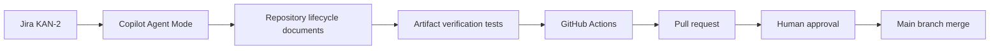

# Automated Documentation Sync Architecture

## Architecture Overview

GitHub Copilot Agent Mode coordinates the capstone lifecycle. Jira issue KAN-2 is read as the source specification. Repository Markdown under `docs/` is the synchronized delivery destination. GitHub Actions verifies the artifacts, and a pull request provides the human review gate.

## Components

| Component | Responsibility |
|---|---|
| Jira KAN-2 | Source of requirements and acceptance criteria |
| Copilot Agent Mode | Drives requirements, architecture, review, planning, implementation, verification, and PR preparation |
| `docs/` | Stores lifecycle artifacts and PR evidence |
| Artifact tests | Reproduce verification and reject missing documents or credential patterns |
| GitHub Actions | Runs tests on pushes and pull requests |
| Pull request | Presents changes and reviewer checklist |
| Human reviewer | Approves implementation and merge |

## Technology Choices

- Jira MCP read access for issue evidence
- GitHub MCP or Git CLI for repository and pull-request operations
- Node.js built-in test runner
- GitHub Actions
- Markdown for lifecycle artifacts

## Data Flow

1. Read Jira issue KAN-2.
2. Generate requirements and architecture documents.
3. Record design review decisions.
4. Create a dependency-ordered implementation plan.
5. Implement and review repository artifacts.
6. Run local and remote verification.
7. Prepare the PR with evidence and limitations.
8. Obtain human approval and merge.

## Security

- MCP credentials and OAuth secrets must remain outside the repository.
- Source conflict resolution is source-of-truth: Jira wins.
- Generated files must not contain tokens or authorization headers.
